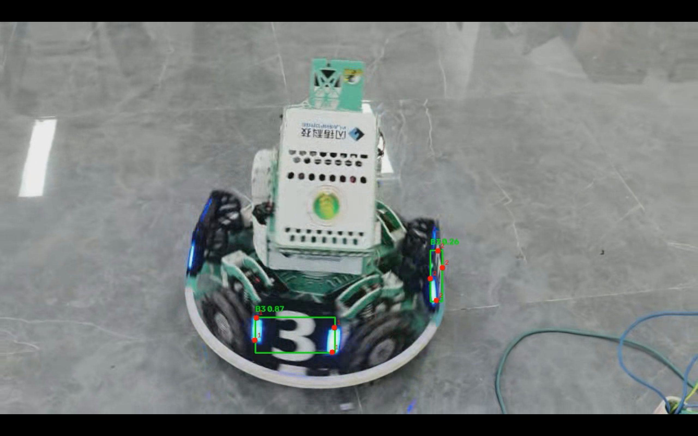
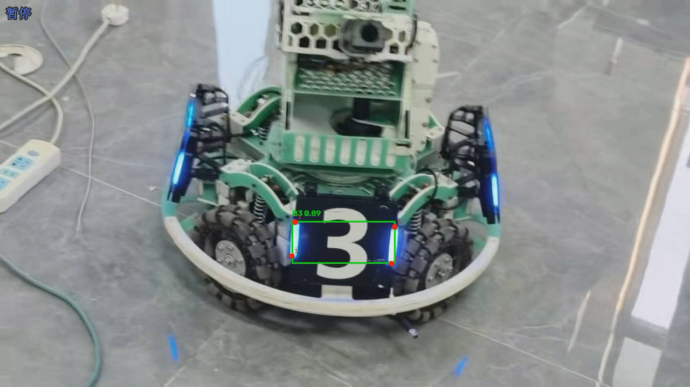

# YOLO 模型格式转换与推理性能对比

## 1. 作业内容
本次作业基于上一份装甲板检测模型，使用 Ultralytics 库将 PyTorch 格式 (.pt) 导出为 ONNX 格式，并使用不同的推理引擎进行测试与对比。

## 2. 运行环境
- Python 3.12.4
- ultralytics, opencv-python, onnx, onnxruntime
- 推理设备：CPU

## 3. 使用方法
- **导出模型**：`python export.py`
- **执行推理**：`python infer.py --model best.onnx --source armorvideo.mp4 --output result_onnx.mp4`

## 4. 性能对比结论
### 性能对比测试

| 对比项目 | 原始 `.pt` 模型 | 导出后的模型 (`.onnx`) |
|---|---|---|
| 模型格式 | `.pt` (PyTorch) | `.onnx` (ONNX) |
| 模型文件大小 | 5.62 MB | 9.7 MB |
| 推理耗时 (CPU) | 21.03 秒 | 31.58 秒 |
| 检测目标数量 | 918帧 | 918帧 |
| 检测效果 | 成功生成 `result.mp4` | 成功生成 `result_onnx.mp4` |

**差异分析：**
ONNX 模型的文件体积比 `.pt` 模型稍大，这是因为 ONNX 格式在保存时包含了更多的计算图结构信息。在 CPU 推理速度上，ONNX 模型通常比原生的 PyTorch 模型更快，因为 ONNX Runtime 针对 CPU 架构做了底层优化。在检测效果和准确率上，两者基本保持一致。

## 5. 结果展示
- 原始模型结果：
- ONNX模型结果：